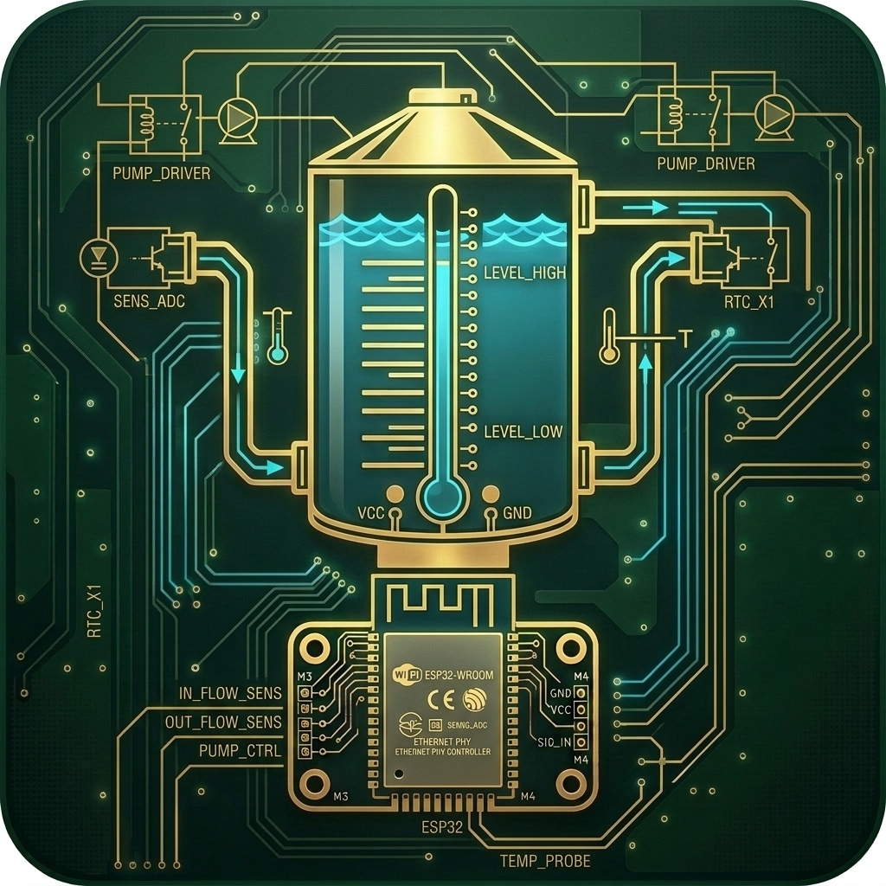

# HydroControl-io 💧🌱

> **Autonomous, Intelligent Hydroponic Automation & Monitoring System for Home Assistant**

<p align="center">
  
</p>

<p align="center">
  <a href="https://www.home-assistant.io"></a>
  <a href="esphome/"></a>
  <a href="LICENSE"></a>
  <a href="https://github.com/Paradigm-Paradox/HydroControl-io/releases"></a>
</p>

---

## 📖 Overview

**HydroControl-io** turns your Home Assistant instance into a centralized, resilient hydroponic management station. Designed for Deep Water Culture (DWC), Nutrient Film Technique (NFT), Ebb & Flow (Flood & Drain), Aeroponics, and automated drip systems.

Powered by versatile **ESP32** microcontrollers (utilizing low-cost, energy-efficient Wi-Fi, Ethernet, and Bluetooth connectivity), HydroControl-io bridges raw hardware probes and relays with advanced agronomic control loops (automated pH & nutrient dosing, pump scheduling, safety limits, leak detection, and climate synchronization).

---

## ⚡ ESP32 Hardware Integration

HydroControl-io provides turnkey **ESPHome** firmware templates for multiple ESP32 configurations:

| Architecture | Connectivity | Best For | Features |
|---|---|---|---|
| **ESP32 Wi-Fi Node** | 2.4 GHz 802.11 b/g/n + BLE | Indoor tents & standard reservoirs | Active Bluetooth proxy for plant BLE sensors, JSN-SR04T ultrasonic level, DS18B20 temp, ADS1115 isolated ADC for pH/EC probes |
| **ESP32 Ethernet POE** | 10/100M LAN8720 / RMII PHY | Commercial racks & wet greenhouse rooms | Zero wireless dropouts, Power-over-Ethernet (PoE) single-cable deployment, low RF interference near ballast lights |

Ready-to-flash templates are available in the [`esphome/`](esphome/) directory:
- [`esphome/esp32_wifi_reservoir.yaml`](esphome/esp32_wifi_reservoir.yaml): Wi-Fi + BLE proxy sensor & pump controller
- [`esphome/esp32_ethernet_reservoir.yaml`](esphome/esp32_ethernet_reservoir.yaml): Hardwired Ethernet POE node for mission-critical reservoirs

---

## ✨ Key Features

- **Automated Dosing Engine:**
  - Dynamic pH regulation (pH Up / pH Down) with pulse-pause intervals and hysteresis safeguards.
  - Multi-part nutrient dosing (A/B/Micro/Grow/Bloom) based on target Electrical Conductivity (EC / PPM / TDS).
  - Safety locks: maximum single dose caps, hourly limits, and lockout on sensor drift/failure.

- **Reservoir & Irrigation Management:**
  - Automated top-off (ATO) with dual float/ultrasonic sensor verification and flood timeouts.
  - Flexible pump cycle modes (continuous, intermittent duty cycle, flood & drain timer, solar-synced).
  - Water temperature regulation with chiller/heater dual-thermostat control.

- **Sensor Calibration & Health Monitoring:**
  - Ingress web UI with step-by-step 2-point and 3-point calibration wizards for pH and EC probes.
  - Sensor health scoring and anomaly detection (sudden jumps, stale readings, dry probe detection).

- **Seamless Home Assistant Integration:**
  - Automatic discovery and bidirectional synchronization via Home Assistant WebSocket/REST API and MQTT.
  - Exposes clean entities (sensors, switches, numbers, selects, and alert alarms) ready for Lovelace cards.
  - Built-in Home Assistant Ingress UI for standalone monitoring, calibration, and live logs.

---

## 🏛 Architecture

```
                  ┌──────────────────────────────────────────────┐
                  │              ESP32 Edge Layer                │
                  │  - ESP32 Wi-Fi / Ethernet POE (ESPHome)       │
                  │  - Analog/I2C Probes: pH, EC, Temp (DS18B20) │
                  │  - Ultrasonic / Float Level Sensors          │
                  │  - Relays: Peristaltic Dosing & Flow Pumps   │
                  │  - BLE Proxy: Flora / RuuviTag BLE Beacons   │
                  └───────────────────────┬──────────────────────┘
                                          │ (Home Assistant Native API / MQTT)
                                          ▼
┌─────────────────────────────────────────────────────────────────────────┐
│                    HydroControl-io (HA Add-on)                          │
│                                                                         │
│  ┌─────────────────────────┐           ┌─────────────────────────────┐  │
│  │   Control Loops Core    │           │     Safety Interlocks       │  │
│  │  - pH Balancer (PID)    │           │  - Dry Run Detection        │  │
│  │  - EC Nutrient Dosers   │◄─────────►│  - Daily Volume Hard Limits │  │
│  │  - Irrigation Scheduler │           │  - Sensor Variance Locks    │  │
│  │  - Auto-Top-Off (ATO)   │           │  - Emergency Halt (E-Stop)  │  │
│  └────────────┬────────────┘           └──────────────┬──────────────┘  │
│               │                                       │                 │
│               ▼                                       ▼                 │
│  ┌─────────────────────────┐           ┌─────────────────────────────┐  │
│  │  FastAPI Backend Engine │           │     Ingress Dashboard UI    │  │
│  │  - State Storage        │◄─────────►│  - Live Telemetry & Gauges  │  │
│  │  - Event Dispatcher     │           │  - Probe Calibration Wizard │  │
│  │  - Config Manager       │           │  - Manual Pump Overrides    │  │
│  └─────────────────────────┘           └─────────────────────────────┘  │
└─────────────────────────────────────────────────────────────────────────┘
```

---

## 📁 Repository Structure

```
├── repository.yaml                   # Home Assistant Add-on repository descriptor
├── README.md                         # Project documentation and architecture guide
├── DESIGN.md                         # System architecture & hardware specification
├── LICENSE                           # MIT License
├── esphome/                          # ESP32 Firmware configurations
│   ├── esp32_wifi_reservoir.yaml     # ESP32 Wi-Fi + BLE sensor & pump controller
│   └── esp32_ethernet_reservoir.yaml # ESP32 Ethernet / POE hardware controller
└── hydrocontrol/                     # HydroControl-io Add-on Package
    ├── config.yaml                   # Add-on configuration & options schema
    ├── build.yaml                    # Multi-architecture build settings
    ├── Dockerfile                    # Container image definition
    ├── icon.png                      # ESP32 water storage add-on icon
    ├── DOCS.md                       # Installation and wiring guide
    ├── CHANGELOG.md                  # Release history
    └── rootfs/app/                   # FastAPI backend, controllers & Ingress UI
```

---

## 🚀 Quick Start (Installation)

1. In Home Assistant, navigate to **Settings** -> **Add-ons** -> **Add-on Store**.
2. Click the three dots in the top right corner and select **Repositories**.
3. Add this repository URL:
   ```text
   https://github.com/Paradigm-Paradox/HydroControl-io
   ```
4. Search for **HydroControl-io**, click **Install**, configure your entity IDs in the configuration tab, and click **Start**.

---

## 📄 License

Distributed under the MIT License. See [LICENSE](LICENSE) for more information.
